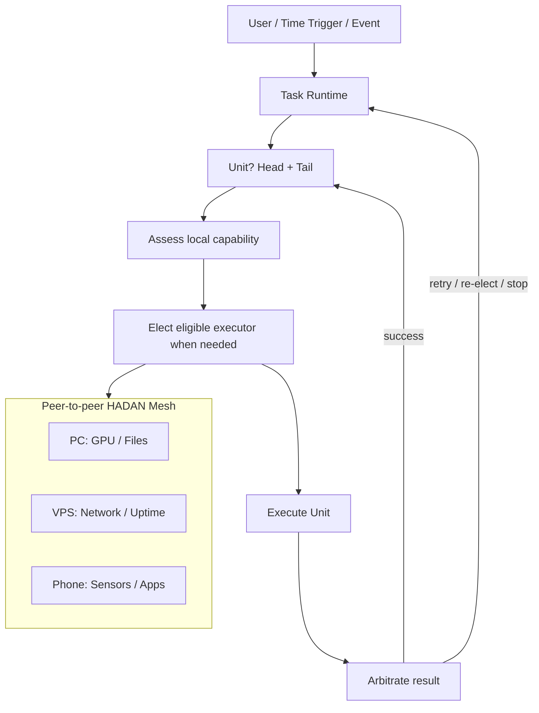

# HADAN — Host-Aware Distributed Agent Network

**Your devices. One intelligent network.**

HADAN (黑蛋) is an experimental, local-first, host-aware distributed agent network that allows personal devices to expose capabilities and collaboratively execute tasks, without requiring a central gateway or an LLM on every node.

> **Status:** Architecture proposal / pre-alpha. No working runtime or interoperable protocol implementation yet.

## Why HADAN?

A desktop has GPU power and local files; a VPS offers stable uptime and remote network access; a phone has sensors and user-facing apps. HADAN aims to discover their capabilities and place work where it fits best, while keeping data local by default.

## Architecture at a glance

## Core objects

`Network · Host · Agent · Capability · Task · Message · StoredObject`

- **Network:** a logical trust domain of authorized peers.
- **Host:** physical/virtual environment, resources and availability.
- **Agent:** peer runtime that assesses, bids for, delegates and executes units.
- **Capability:** typed, host-dependent service; Channels and LLMs are optional capabilities.
- **Task:** durable intent and its execution units/attempts.
- **Message:** cross-node envelope with correlation and causation identifiers.
- **StoredObject:** local-first object with authority, version and replica policy.

## Principles

1. **Equal peers, different capabilities:** no mandatory gateway or permanent supervisor role.
2. **Host-aware scheduling:** consider CPU/GPU, memory, network, power, data locality and uptime.
3. **LLM optional:** deterministic routing where possible; remote intelligence as a capability.
4. **Incremental planning:** break dynamic tasks into an executable Head and remaining Tail.
5. **Explicit execution outcomes:** `SUCCESS`, `FAILED`, `STOPPED` and bounded arbitration.
6. **Global schedule visibility:** replicated schedule definitions; one assigned trigger agent, no automatic failover in v0.1.
7. **Local-first storage:** SQLite and local artifacts, selected metadata replication, restricted secrets.
8. **Safety by design:** authorization at the executor, bounded delegation, idempotency and audit trails.

## What is in this repository?

- [`docs/core-protocol-v0.1.html`](docs/core-protocol-v0.1.html): illustrated conceptual architecture.
- [`docs/mvp.md`](docs/mvp.md): proposed proof-of-concept plan and success criteria.
- [`docs/decisions.md`](docs/decisions.md): early architecture decisions and open questions.
- [`examples/schedule.json`](examples/schedule.json): draft example, **not** a validated wire schema.

## First milestone

Demonstrate two connected peer agents on separate hosts, with capability discovery, a simple task dispatched across peers, durable results and observable task history. Add a third peer, a fixed-assignment schedule and optional LLM capability only after the two-peer path works.

## Scope and non-goals

HADAN v0.1 is **not** a production-ready remote execution framework, a full P2P consensus database, an autonomous money-transfer agent, or a replacement for A2A/MCP. We will evaluate interoperability and reuse established protocols when practical.

## Feedback

Issues and design critiques are welcome. In particular, we want to test whether host-aware placement beats a simple rules-only baseline enough to justify added complexity.

## License

MIT — see [LICENSE](LICENSE).